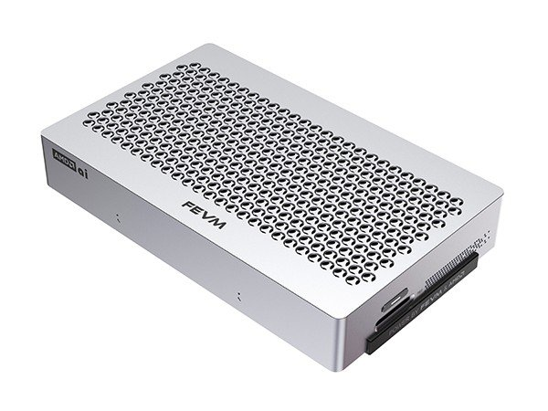

# FEVM FAEX1



[[OFFICIAL SITE](https://fevmpc.com)]

A ~1 liter mini PC from FEVM with the Ryzen AI Max+ 395 and 128GB RAM.

### Hardware

- **APU:** Ryzen AI Max+ 395, Radeon 8060S (gfx1151)
- **RAM:** 128GB LPDDR5X at 8000 MT/s (Micron MT62F4G32D8DV-023 WT)
- **Storage:** 3× M.2 PCIe 4.0 x4 (one shares lanes with OCuLink)
- **I/O:** OCuLink, 2× USB4, 10GbE (Marvell AQC113) + 2.5GbE (Realtek, `r8169`), Wi-Fi 7 / BT (MediaTek MT7925)
- **Size / weight:** 220 × 133 × 35 mm, ~1.15 kg
- **Retail box:** 33 × 23 × 10 cm
- **PSU:** external 245W GaN brick (YL245W1225, 20V × 12.25A)
- **Cooling:** two blower fans, aluminum case with a vented top
- **EC:** ITE IT5571

### Firmware

Official downloads: fevmpc.com → Support → Driver Download → "FAEX1 BIOS and EC". Older versions are mirrored on [archive.org](https://archive.org/details/fevm-faex1-firmware-drivers).

Latest: BIOS 1.06 (2026-07-20), EC 1.29.

**BIOS update without Windows** (from a UEFI Shell USB stick, tested 1.03 → 1.06):

- The 1.06 archive is missing the `efi/Boot` folder with the UEFI Shell, and its BIOS folder is not named the way the script expects. Build a FAT32 USB stick like this:
  ```
  efi/Boot/BootX64.efi     <- from the 1.03 archive (UEFI Shell)
  efi/Boot/startup.nsh     <- from the 1.03 archive
  0_Afu_Flash/             <- contents of FAEX1_1.06_BIOS from the 1.06 archive (Flash.cmd, *.bin, Tools/)
  ```
  `0_Afu_Flash` must contain exactly one `.bin`.
- Disable Secure Boot (the shell is unsigned), boot from the stick (F7), `startup.nsh` runs AFU with `/CAPSULE /P /B /N /K /L /X /RLC:E`; confirm with `y`, the machine reboots into the BIOS flash screen and reboots again.
